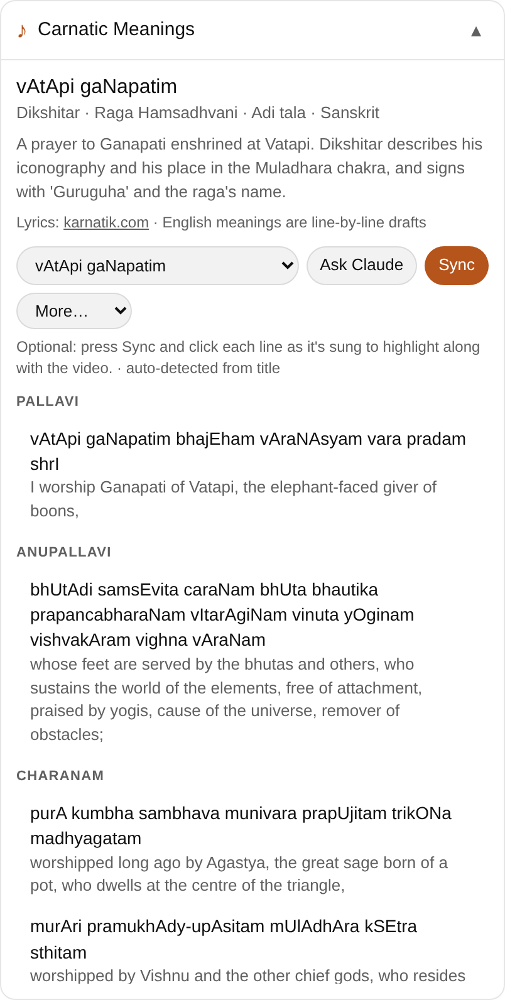
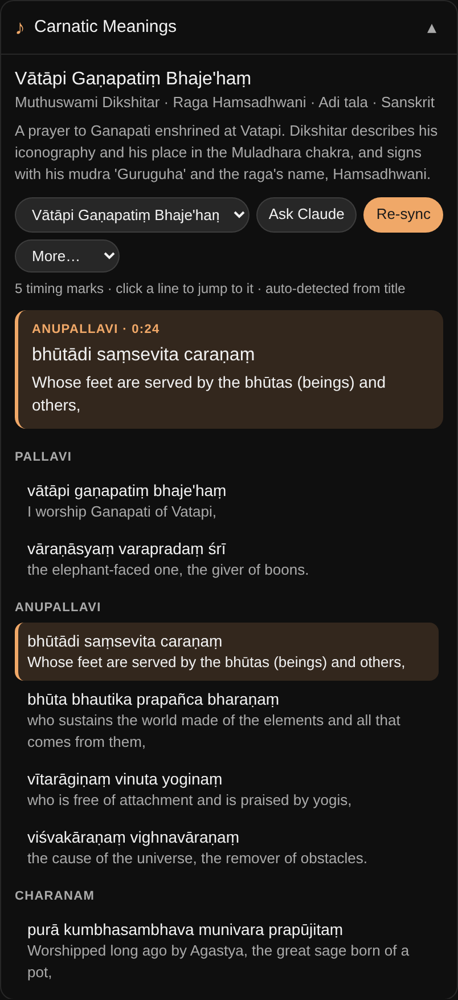

# Carnatic Meanings for YouTube

A Chrome extension that shows the lyrics and English meaning of a Carnatic song in YouTube's right-hand sidebar. As the video plays, the line being sung is highlighted.

<p>
  
  
</p>

## How it works

1. **Finding the song.** The extension compares the video title with its database of 224 frequently performed concert pieces, allowing for different spellings (*Vathapi / Vaatapi / vAtApi*, *Bantureethi / banTu rIti*, *Alaipayuthey / alai pAyudE*). Short titles such as *Ilalo* only count when the raga name is in the title too. If nothing matches, pick the song from the dropdown.
2. **Reading along.** The sidebar lists every line of the song, section by section, each with its English meaning, plus a short summary of the song. That's all you need to follow a concert.
3. **Optional timing.** To have the current line highlighted, press **Sync** and click each line as it begins (keys: **N** next line, **R** repeat line, **U** undo). Chips mark *Alapana, Tanam, Niraval, Kalpanaswaram* and *Tani avartanam*. Timings are saved per video, because no two performances have the same timing, and can be exported or imported as JSON.

## The song database

`src/data/songs.json` is built from two parts:

| Part | Where it comes from |
|---|---|
| Lyrics, raga, tala, language | Scraped from [karnatik.com](https://www.karnatik.com) by `tools/scrape_karnatik.py` (one request per second, cached). Each song keeps a link to its source page. |
| Line-by-line English meanings and summaries | Written for this project in `data/meanings/*.json`. karnatik.com's own meanings are prose paragraphs written by the site, so they aren't copied. |

- **Which songs.** `tools/top_songs.tsv` is a hand-curated list of 224 pieces that come up often in concerts: Tyagaraja (131), Dikshitar (34), Syama Sastri, Swati Tirunal, Purandaradasa, Annamacharya, Sadasiva Brahmendra, Oottukkadu and others. No public dataset of concert frequencies was available, so this list reflects common repertoire rather than measured counts.
- **Copyright.** The list only includes composers whose works are in the public domain in India (died before 1966). Popular pieces by Papanasam Sivan, Periyasami Thooran and others are left out for that reason.
- **Accuracy.** The meanings were drafted with AI assistance, and some lines are approximate, especially where the karnatik.com text is irregular. They haven't yet been reviewed by a Sanskrit, Telugu, Tamil or Kannada scholar. Corrections to `data/meanings/*.json` are welcome.

To rebuild or extend the database:

```bash
python3 tools/scrape_karnatik.py          # fetch lyrics for every row in tools/top_songs.tsv
python3 tools/show_batch.py 0 20          # print songs 0-19 with numbered lines, to write meanings
python3 tools/build_songs.py              # merge lyrics + meanings into src/data/songs.json
```

`build_songs.py` refuses to build if a song's number of meanings doesn't match its number of lines. A song without meanings is left out.

## "Ask Claude" (optional)

For songs not in the database, **Ask Claude** sends the video's title and description to the Claude API (`claude-opus-5-5` by default). It returns the composition's lyrics, line-by-line meanings and word-by-word glosses. The result is saved as a custom song and can be timed like any other.

- Set your Anthropic API key in the extension's settings (click the toolbar icon). The key is stored only in `chrome.storage.local`, and requests go directly to `api.anthropic.com`, billed to your key.
- Claude is told to say when it can't identify a song rather than guess. Songs it generates are labelled *"Generated by Claude — may contain errors"* and should be checked before you rely on them.
- Server-side refusal fallback is enabled (`fallbacks: "default"`).

## Install (developer mode)

```bash
cd carnatic-meanings-extension
npm install
npm run build          # outputs ./dist
```

Then open `chrome://extensions`, turn on **Developer mode**, click **Load unpacked** and choose the `dist` folder.

## Tests

```bash
npm test
```

This runs unit tests for title matching and cue lookup, and an end-to-end test. The end-to-end test loads the built extension in headless Chromium against a mock YouTube watch page served by Playwright routing, so it doesn't contact YouTube. It needs `playwright` (with Chromium) and `ffmpeg` available.

## Layout

```
tools/                scraper, curated song list and database build script
data/lyrics_raw.json  scraped lyrics (input to the build)
data/meanings/        line-by-line meanings, one JSON file per batch of songs
src/manifest.json     MV3 manifest
src/content.js        sidebar UI, sync mode, playback tracking, SPA navigation
src/lib/match.js      title → song matching (phonetic key over transliterations)
src/lib/cues.js       cue model: active cue lookup, seek targets
src/background.js     song list + Claude generation (bundled with the Anthropic SDK)
src/data/songs.json   built song database (generated — edit data/ and rebuild)
src/options.*         settings page (API key, model)
```

## Ideas for next steps

- A shared, community-maintained timing file keyed by video ID, so popular recordings work without anyone syncing them first.
- Review of the meanings by native speakers, and word-by-word glosses.
- Automatic alignment, using the YouTube transcript when one exists or audio-based alignment.
- Tamil, Telugu, Kannada and Devanagari script display alongside the transliteration.
