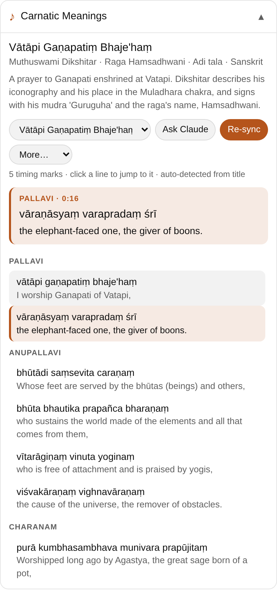

# Carnatic Meanings for YouTube

A Chrome extension that shows the lyrics and English meaning of a Carnatic song in YouTube's right-hand sidebar. As the video plays, the line being sung is highlighted.

<p>
  
  
</p>

## How it works

1. **Finding the song.** The extension compares the video title with a song database, allowing for different spellings (*Vathapi / Vaathapi / Vātāpi*, *Bantureethi / Bantu Rīti*). If nothing matches, you can pick the song from the dropdown, import a JSON file, or click **Ask Claude**.
2. **Timing.** The same kriti never has the same timing twice: sangatis repeat lines, singers return to the pallavi, and alapana or niraval can last any length. So timings are stored **per video** as a list of cues (`{t, ref}`), and a line can appear any number of times.
   - Press **Sync** and click each line as it begins, or use the keys: **N** for the next line, **R** to repeat the current line, **U** to undo. Chips mark *Alapana, Tanam, Niraval, Kalpanaswaram* and *Tani avartanam*. During niraval, the line being elaborated stays highlighted.
   - 0.4 s is subtracted from each tap to allow for reaction time. Tapping again at the same moment replaces the earlier mark.
   - Timings are saved in the browser. Use **More → Export** to share them as JSON, and **Import** to load them on another machine.
3. **Playback.** The *now playing* card and the highlight follow the playhead. Clicking a timed line jumps the video to it.

## Built-in songs

| Song | Composer | Raga |
|---|---|---|
| Vātāpi Gaṇapatiṃ | Muthuswami Dikshitar | Hamsadhwani |
| Nagumomu Ganaleni | Tyagaraja | Abheri |
| Bantu Rīti Koluvu | Tyagaraja | Hamsanadam |

To add a song, add an entry to `src/data/songs.json` (each line needs a unique `id`, the `text` and its `meaning`; `words` with word-by-word glosses is optional). You can also import a JSON file holding a single song object.

## "Ask Claude" (optional)

For songs not in the database, **Ask Claude** sends the video's title and description to the Claude API (`claude-opus-5-5` by default). It returns the composition's lyrics, line-by-line meanings and word-by-word glosses. The result is saved as a custom song and can be timed like any other.

- Set your Anthropic API key in the extension's settings (click the toolbar icon). The key is stored only in `chrome.storage.local`, and requests go directly to `api.anthropic.com`, billed to your key.
- Claude is told to say when it can't identify a song rather than guess. Songs it generates are labelled *"Generated by Claude — may contain errors"* and should be checked before you rely on them.
- Server-side refusal fallback is enabled (`fallbacks: "default"`).

## Install (developer mode)

```bash
cd carnatic-meanings-extension
npm install
npm run build          # outputs ./dist
```

Then open `chrome://extensions`, turn on **Developer mode**, click **Load unpacked** and choose the `dist` folder.

## Tests

```bash
npm test
```

This runs unit tests for title matching and cue lookup, and an end-to-end test. The end-to-end test loads the built extension in headless Chromium against a mock YouTube watch page served by Playwright routing, so it doesn't contact YouTube. It needs `playwright` (with Chromium) and `ffmpeg` available.

## Layout

```
src/manifest.json     MV3 manifest
src/content.js        sidebar UI, sync mode, playback tracking, SPA navigation
src/lib/match.js      title → song matching (phonetic key over transliterations)
src/lib/cues.js       cue model: active cue lookup, seek targets
src/background.js     song list + Claude generation (bundled with the Anthropic SDK)
src/data/songs.json   built-in songs
src/options.*         settings page (API key, model)
```

## Ideas for next steps

- A shared, community-maintained timing file keyed by video ID, so popular recordings work without anyone syncing them first.
- Automatic alignment, using the YouTube transcript when one exists or audio-based alignment.
- Tamil, Telugu, Kannada and Devanagari script display alongside the transliteration.
